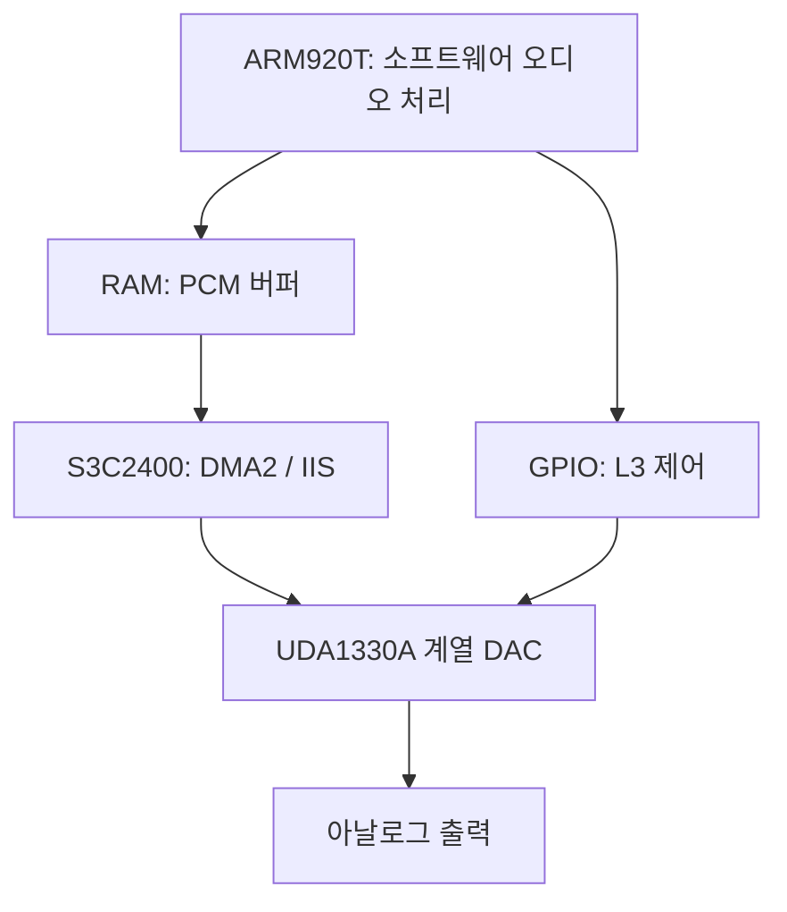

# GP32emu 1.1.0 추가 검토: 명령어, 오디오 하드웨어, 정확성과 성능

검토일: 2026-10-17 UTC. [첫 검토](REVIEW-1.1.0.md)를 잇는 문서다.
기준은 PR의 `43cdc06b4ab917c62919cc7ac7c8c8e344fd0c50`이며,
작업용 기준 커밋 `86eb4f98ad893b99eb5f94ebb5b9093252475611`과 파일 트리가 같다
(`9586014379c113ff54b05c2c4d5f70095c5c3782`).
각 성능 실험은 이 기준에 해당 변경만 적용한 비교다. 전체 패치의 게임 성능을
합산해서 나타낸 수치가 아니다.

이번 검토의 목표는 실제로 재현되는 코어 오류를 고치고, 출력이 동일하며 측정에서
이득이 확인된 최적화를 남기는 것이다. Android/iPhone/휴대용 게임기 실물,
게임 ROM, BIOS를 사용한 플레이 테스트는 수행하지 않았다.

이 문서의 44개 CTest와 CPU 코드 쓰기 88개 사례는 당시 검증 스냅샷이다.
이후의 Thumb·IRQ·카드 수정, 일반 RAM DMA 최적화, 미채택 JIT 실험과
최종 49개 CTest/CPU 코드 쓰기 90개 결과는 [심층 재검토](REVIEW-1.1.0-DEEP.ko.md)에 있다.

## 1. GP32에서 다섯 가지 DSP 곱셈 명령을 쓰는가?

**GP32의 ARM920T에서 정상적인 CPU 명령으로 실행할 수 없다.**
ARM920T의 ARM9TDMI 코어는 ARMv4T이며, 질문에 나온 명령은 ARMv5TE 확장이다.

| 명령 계열 | 의미 | GP32의 ARMv4T |
|---|---|---|
| `SMLAxy` | 선택한 signed 16비트 값 두 개의 곱을 32비트 값에 누산 | 미지원 |
| `SMLAWy` | signed word × halfword 결과의 상위 부분을 누산 | 미지원 |
| `SMULWy` | signed word × halfword 결과의 상위 부분 | 미지원 |
| `SMLALxy` | signed halfword 곱을 64비트 값에 누산 | 미지원 |
| `SMULxy` | 선택한 signed halfword 두 개의 곱 | 미지원 |
| `MUL`, `MLA`, `UMULL`, `UMLAL`, `SMULL`, `SMLAL` | ARMv4의 기본/long 곱셈과 누산 | 지원 |

특히 **`SMLAL`과 `SMLALxy`는 다른 명령**이다. 기존 ARMv4 곱셈을 빼거나
느린 예외 경로로 보내면 안 된다. 첫 검토의 수정은 공유 ARMv4T 검증기에서
미지원 인코딩을 undefined exception으로 보내며, 조건이 거짓이면 실행하지 않는
기존 조건 실행 규칙을 유지한다. 기본 곱셈 6종은 양성 대조 테스트로 남겼다.

근거: ARM Architecture Reference Manual DDI 0100I, A3.16.3/Table A3-5 및
각 명령의 architecture 항목; ARM920T TRM DDI 0151C, 2.2.2.
문서 링크는 [자료 목록](#9-자료-목록)에 있다.

이것은 ISA에 관한 결론이다. 모든 GP32 게임 바이너리를 조사했다는 뜻은 아니다.
올바른 GP32 타깃으로 빌드한 프로그램이 이 명령을 네이티브 연산으로 사용할
것이라고 기대할 근거는 없다. 바이너리에서 같은 비트 패턴을 발견하더라도
데이터, 실행되지 않는 코드, CPU 감지용 코드, undefined handler를 이용한
소프트웨어 처리일 수 있어 실제 실행 여부를 별도로 확인해야 한다.

저장소에는 이번 검토에 사용할 게임/BIOS 이미지가 없었다. 공개된 원래 GP32
PCM 예제 소스도 확인했으며, 그 예제의 Makefile은 `-mcpu=arm9tdmi
-march=armv4t`를 사용한다. 이 한 예제가 전체 게임의 사용 현황을 대표하지는 않는다.

## 2. 별도 오디오 칩과 회로 자료

원래 GP32 개발자가 공개한 `gp32_sound_v0.02.zip`의 PCM 예제는 S3C2400의
DMA2/IIS와 UDA1330A DAC 제어를 보여 준다. `Init1330`, `InitIIS`, DMA 설정,
GPE9/10/11을 이용한 L3 제어 코드가 포함되어 있다. 현재 저장소의
[gp32_codec.h](../src/gp32_codec.h)도 이 L3 DAC를 모델링한다.

아래는 소스와 부품 문서에서 확인한 **기능 흐름**이다. GP32 보드의 배선도를
복원한 그림은 아니다.



NXP의 UDA1330ATS 데이터시트는 이 부품을 stereo filter DAC로 설명한다.
직렬 PCM 입력, 필터, 음량/뮤트/디엠퍼시스 제어와 아날로그 변환 기능을 가지며,
ARM 프로그램을 받아 실행하는 별도 CPU/DSP라는 근거는 없다. 이 칩이 있다는
사실이 ARM920T에 ARMv5TE 명령을 추가하지 않는다. 호스트 컴파일러가 SSE2나
NEON을 쓰는 것 역시 에뮬레이트하는 GP32의 ISA와 별개다.

확인한 회로 자료는 제조사 데이터시트의 **17쪽 Fig. 9 응용 회로**다.
GP32 전체 보드의 검증된 회로도/netlist는 이번 조사에서 확보하지 못했다.
부품 응용 회로를 GP32 완성품 회로도로 소개하지 않는다. 기판 리비전별 부품
실물 확인도 수행하지 않았다. 오래된 2차 사양 모음보다 원래 예제 소스와
제조사 문서를 우선했다.

원본 예제 압축 파일 SHA-256:
`9821a6b7d877b5633766886d9118e64799a64edeb0afb1c7ed25c044afa4a561`.
외부 예제를 실행하거나 제품에 복사하지 않고 소스만 읽었다.

## 3. 캐시된 store의 버스 쓰기 권한 수정

파일: [코어](../src/arm920t.c), [버스 계약](../src/arm920t.h),
[회귀 테스트](../tests/arm_write_permission_test.c).

### 문제와 수정

버스가 읽기용 fastmem을 제공해도 쓰기용 fastmem까지 허용한다는 보장은 없다.
기존 cached store helper는 읽기에서 얻은 `jit_ram_base`를 재사용했다.
읽기는 허용하고 쓰기는 콜백으로 거절하는 버스에서 raw interpreter는 쓰기를
거절하지만, cached portable 경로와 native fallback은 RAM을 바꾸는 차이가
재현됐다.

`jit_ram_write_base`를 별도로 캐시하고 실제 store에 사용하도록 수정했다.
전체 쓰기 window가 없으면 접근별 fastmem 또는 쓰기 콜백으로 내려간다.
읽기와 쓰기의 backing이 다른 경우도 구분한다. 일반 GP32 SDRAM의 빠른 경로는
계속 포인터를 사용하며, 모든 store마다 권한 콜백을 새로 호출하지 않는다.

API/CP15/TLB invalidation에서 읽기·쓰기 window를 함께 갱신한다. 쓰기 window만
달라져도 이미 컴파일된 native store가 옛 권한을 쓰지 않도록 generation을
바꾼다. reset/JIT disable/state load 직후에는 포인터를 비우고 다음 블록에서
필요할 때 얻는다. 버스의 매핑을 바꾼 호출자는 다음 guest 실행 전에 cache flush를
요청해야 하며, 쓰기 콜백 안에서 변경하고 flush하는 경우도 검증했다.

이 수정은 **호스트 버스의 `fastmem(write=1)` 계약**에 대한 것이다.
ARM MMU의 AP/domain fault 모델을 완성한 수정으로 해석하면 안 된다.
일반 GP32 SDRAM은 쓰기 가능하므로, 이 재현만으로 특정 게임 버그를 주장하지 않는다.
추가 포인터는 파생 실행 상태이고 저장 상태의 직렬화 형식은 바꾸지 않았다.

### 검증과 비용

거절된 쓰기, 부분 window, 읽기/쓰기 backing 분리, STR/STRB/STRH/STM/SWP,
writeback, reset/state load, 실제 native 실행, 콜백 중 권한 회수 등을 검사한다.
수정 전 코어에서 새 테스트의 118개 assertion이 실패했고, 수정 후 통과했다.

이 변경만의 합성 쓰기 벤치마크는 6천만 guest 명령을 실행했다.
4개 측정값의 중앙값은 native 80.414→80.243ms로 사실상 동일했고,
cached portable은 530.322→485.306ms였다. 후자는 코드 배치와 컴파일러 영향도
포함한 한 루프의 결과이므로 게임에서 8.5% 빨라진다고 주장하지 않는다.
추가 SMC 검사를 포함한 최종 코어의 전체 성능 수치도 아니다.

처음에는 reset 시점에 포인터를 즉시 얻는 안을 시도했지만 기존 polling 테스트
6건을 깨뜨렸다. 그 안은 버리고 lazy acquisition을 유지했다.

## 4. I-cache가 꺼진 상태의 CPU 자기 수정 코드

파일: [코어](../src/arm920t.c), [AArch64 emitter](../src/arm920t_jit_a64.inc),
[CPU 쓰기 회귀 테스트](../tests/arm_cpu_code_write_test.c).

### 오래된 명령을 실행하는 재현

CP15 c1이 `0x70`인 상태에서 RAM의 `MOV r0,#0x11`을 한 번 실행한 뒤,
guest STR로 `MOV r0,#0x22`로 바꾸고 다시 호출했다. RAM은 바뀌었지만
cached portable/native 실행은 0x11을 반환했다. raw interpreter는 0x22였다.
게임 문제 보고와 별개로 재현되는 instruction coherence 오류다.

ARM920T TRM 4.2.2–4.2.3은 I-cache disable 상태에서 cache 내용을 무시하고
명령을 메모리에서 fetch한다고 설명한다. 에뮬레이터의 decoded/native block을
재사용하는 최적화도 이 조건을 유지해야 한다.

### 물리 instruction word 감시와 trace 종료

fetch/재검증할 때 **물리 주소의 4바이트 word**를 감시표에 기록한다.
I/D 가상 주소가 달라도 같은 물리 코드를 쓴 것을 알 수 있다.
바이트가 같은 새 물리 페이지로 remap하여 기존 블록을 재사용한 경우에도
새 페이지를 기록한다. 긴 proof span은 처음/끝뿐 아니라 중간 word까지 포함한다.

raw ARM/Thumb store와 cached helper는 쓰기 후 코드를 건드렸는지 알린다.
native store는 **실제 메모리나 writeback을 바꾸기 전에** 감시표를 검사한다.
코드에 닿으면 해당 명령 전체를 checked helper로 실행하고, 모든 STM lane과
writeback을 끝낸 뒤 기존 epoch/generation 검사를 통해 오래된 trace에서 나온다.
다음 dispatcher 조회만 무효화해서 현재 trace 안의 옛 명령이 계속 실행되는
허점을 남기지 않도록 했다.

STM은 처음과 끝 두 word만 보는 것으로 충분하지 않다. 최대 16개 word 범위의
bitmap을 마스크로 검사한다. AArch64의 두 페이지 경로는 각 물리 fragment를
각자의 길이로 검사하므로, 가상으로 이웃한 페이지의 물리 주소가 이어져 있다는
가정을 하지 않는다. 마지막 RAM word 근처에서 64비트 bitmap window를 안전하게
읽도록 감시표 끝에 0인 padding word 하나를 둔다.

CP15.I가 켜진 채로 컴파일한 native store에는 새 검사를 생성하지 않는다.
guest가 c1을 쓰면 기존 제어 상태 전환이 generation을 바꾸므로 이 전제를
유지할 수 있다. 실제 guest `MCR`로 I=1→0을 바꾼 후 다시 store하는 테스트를
추가했다. **I-cache 전체, I=1인 noncacheable mapping, 파이프라인 timing까지
완성한 모델은 아니다.** 기존 I=1 maintenance 정책은 그대로 둔다.

### 정확성을 지키면서 오탐 비용 줄이기

처음에는 4KiB 단위 감시를 시도했으나 코드와 변수가 같은 페이지에 있으면
쓰기 루프가 약 2.78→12.98ns/guest instruction으로 느려졌다. 이 초기 측정은
문제를 찾기 위한 관찰이며 아래 최종 반복 실험과 별개다.

64바이트 단위로 좁힌 후보도 다시 측정했다. 같은 페이지의 멀리 있는 변수는
괜찮았지만 같은 64바이트 안의 변수는 약 6배의 비용을 만들었다. 그래서 이
후보를 제품 코드로 그대로 채택하지 않고 **4바이트 word 감시**로 줄였다.
word 감시표는 8MiB RAM에 대해 256KiB + 4바이트 padding을 사용한다.
64바이트 후보보다 표 자체가 240KiB 크다. 이는 CPU당 파생 metadata이며
save-state wire 형식을 늘리지 않는다. 구조체 정렬 padding은 호스트 ABI에 따른다.

baseline/미채택 64바이트 후보/최종 4바이트 후보를 같은 호스트에서 교차 측정했다.
GCC 13.3 `-O3 -std=c2x`, profiling on, CPU 0 고정, 30,000명령 warmup 후
30,000,000명령씩 5회다. 24개 조건의 총 360개 원시 측정값을
[JSON](measurements/cpu-code-write-words-x64.json)에 보관했다.
아래는 I=0 native 경로의 중앙값(ns/guest instruction)이다.

| 쓰기 루프와 배치 | MMU | 수정 전 | 미채택 64B | 최종 4B | 수정 전 대비 시간 |
|---|---:|---:|---:|---:|---:|
| STR, 다른 페이지의 변수 | off | 2.1158 | 2.4150 | 2.3910 | +13.0% |
| STR, 코드와 같은 64B 안의 변수 | off | 2.1125 | 13.2249 | 2.4273 | +14.9% |
| STR, 다른 페이지의 변수 | on | 2.5438 | 2.7204 | 2.6898 | +5.7% |
| STR, 코드와 같은 64B 안의 변수 | on | 2.5915 | 17.1964 | 2.8490 | +9.9% |
| STM16, 다른 페이지의 변수 | off | 2.9803 | 3.5243 | 3.2421 | +8.8% |
| STM16, 코드와 같은 64B 안의 변수 | off | 3.1431 | 37.1369 | 3.3411 | +6.3% |
| RAM을 4KiB stride로 순회 | off | 1.3529 | 1.5919 | 1.5726 | +16.2% |
| RAM을 4KiB stride로 순회 | on | 1.6340 | 1.8596 | 1.8712 | +14.5% |

I=1 native 대조군은 -1.95%에서 +0.76% 사이였다. guard를 생성하지 않는 경로의
변동으로 보며 개선을 주장하지 않는다. I=0의 다른 페이지 STR 대조군에서
cached portable은 MMU off/on 각각 +0.3%/+7.2%, raw는 +7.2%/+4.9%였다.
이 결과는 비용을 숨기지 않고 비교하기 위한 쓰기 중심의 합성 루프다.

최종 [회귀 테스트](../tests/arm_cpu_code_write_test.c)는 88개 시나리오다.
word/byte/halfword, SWP/SWPB, STM의 중간 word, 현재 trace 수정, raw ARM/Thumb
writer, I/D 별도 매핑, 긴 remap proof, RAM 경계, 실제 MCR 전환과 같은 64B 안의
일반 데이터 쓰기를 포함한다. 가상으로 이웃하지만 물리적으로 떨어진 두 페이지의
두 번째 fragment도 검사한다. 이 경우 첫 물리 페이지의 이웃을 대신 검사하도록
AArch64 코드를 일부러 바꾼 변형은 0x22 대신 0x11을 반환하며 두 assertion이
실패했다. 최종 구현은 x86-64와 AArch64 QEMU에서 88개 모두 통과했다.

초기 44개 재현은 수정 전 72개 assertion이 실패했다. 감시 단위만 4바이트로
줄이고 STM 범위 마스크를 고치지 않은 변형도 x86-64에서 8개, AArch64에서 12개
assertion이 실패했다. 따라서 성공 결과뿐 아니라 놓치기 쉬운 잘못된 구현을
검출하는지도 확인했다. 자세한 범위와 재현 명령은
[CPU 코드 쓰기 기술 문서](CPU-CODE-WRITES.md)에 기록했다.

이 변경은 정확성 수정이다. I=0의 일반 store에도 검사 비용이 들고 실제 코드
쓰기는 helper/재검증 비용을 낸다. I=1 경로에 새 native guard가 없다는 사실도
모든 게임의 실행 시간이 같다는 보장은 아니다. cold compile, cache maintenance,
실제 ARM 기기의 cache/memory 특성은 별도 측정이 필요하다.

## 5. 정확한 SSE2 오디오 FIR 최적화

파일: [resampler](../src/audio/gp32_audio_resampler.c),
[독립 수학 참조 테스트](../tests/audio_resampler_test.c),
[비교 드라이버](../scripts/audio_resampler_compare.c),
[실행 스크립트](../scripts/bench_audio_resampler.py).

### 연산을 바꾸지 않고 4프레임씩 계산

기존 65-tap/256-phase 필터, 계수 생성, phase 진행, 히스토리, clipping,
fade 동작을 유지했다. x86에서 SSE2가 사용 가능하면 연속 입력과 과거 샘플
모두에 공통 4프레임 누산 helper를 사용한다. 계수와 샘플의 signed 16비트 곱을
만들고 **각 곱을 64비트로 확장한 뒤 합한다.** 남는 tap은 scalar로 처리한다.

`PMADDWD`로 32비트에서 먼저 둘을 더하는 짧은 구현은
`(-32768 × -32768) + (-32768 × -32768)`에서 overflow할 수 있다.
빠르게 보이는 intrinsic 한 줄로 바꾸기보다 기존 wide sum과 정확히 같게 만들었다.
unaligned 입력, 좌우 채널 순서, source/history 경계에서 유효한 샘플만 읽도록 했다.

SSE2를 사용할 수 없는 타깃은 기존 scalar 경로를 사용한다. 이번 AArch64 GCC
비교에서 resampler의 `.text`는 변경 전후 바이트 단위로 같았다.
이 최적화로 Android ARM/iPhone/ARM 게임기의 속도가 올랐다고 주장하지 않는다.
ARM용 NEON은 실제 ARM에서 측정하지 못했으므로 추가하지 않았다.

### 정확성 검증

- 최적화의 source/history 분할을 복제하지 않은 수학 정의로 **2,752,512개의
  L/R 누산 쌍**을 비교했다. 8개 입력 정렬, 256 phases, previous sample 유무,
  경계 인덱스, 7개 rate 조합과 극단 PCM/계수를 포함한다.
- 변경 전후 소스를 각각 컴파일하여 **1,024개 스트림 블록, 278,448개 stereo
  PCM 프레임**과 각 블록 후의 전체 resampler 상태가 같은지 비교했다.
  rate/ppm 변경, 출력 용량 제한, reset, copy, gap도 포함한다.
- GCC의 SSE2/scalar 경로, AArch64 QEMU, ASan+UBSan 실행이 통과했다.
  여기서 ASan 실행은 환경 제약으로 leak detection을 끈 메모리 접근 검사다.
- 32비트 누산이나 프레임 순서를 잘못 배치한 shuffle을 일부러 넣은 변형은 실패했다.
  단순히 같은 구현 두 개를 실행하는 테스트에 머물지 않도록 확인했다.

### 시간 측정

AMD EPYC 9V74, Linux x86-64, CPU affinity 고정, 동일 `-O3 -DNDEBUG`로 비교했다.
GCC 13.3은 `-std=c2x`, Clang 18.1.3은 `-std=c23`을 사용했다.
계수 생성/초기 준비는 타이밍 밖에서 수행했고, 매 회차 baseline/candidate의
순서를 바꾸어 인접 실행했다. 7회, 회차당 약 50만 output frame,
3개 rate × 5개 block 크기다. 단위 frame은 **좌우 한 쌍**이다.

23,144→44,100Hz에서의 중앙값(ns/output stereo frame):

| 입력 block | GCC 전 | GCC 후 | 시간 감소 | Clang 전 | Clang 후 | 시간 감소 |
|---:|---:|---:|---:|---:|---:|---:|
| 1 | 90.85 | 40.17 | 55.8% | 62.42 | 42.84 | 31.4% |
| 32 | 82.86 | 32.13 | 61.2% | 47.53 | 33.78 | 28.9% |
| 128 | 77.32 | 33.43 | 56.8% | 59.24 | 36.45 | 38.5% |
| 512 | 74.26 | 33.52 | 54.9% | 57.52 | 33.22 | 42.2% |
| 2,048 | 73.66 | 32.11 | 56.4% | 56.79 | 36.83 | 35.1% |

15개 조합 전체에서 중앙값이 감소했다. 감소 범위는 GCC 44.4–62.4%,
Clang 22.9–43.9%였다. 호스트 변동성이 있으며 특히 Clang의 회차 차이가 있다.
[GCC 원시 CSV](benchmarks/1.1.0-followup/audio-sse2-gcc.csv)와
[Clang 원시 CSV](benchmarks/1.1.0-followup/audio-sse2-clang.csv)를 함께 보관했다.

이 비율은 resampler 처리 경과 시간의 감소다. 예를 들어 GCC/block 512의
74.26→33.52ns를 44,100 stereo frame의 처리 시간으로 단순 환산하면
약 3.27→1.48ms다. 타이머는 `CLOCK_MONOTONIC`이며 process CPU-time 계측은 아니다.
에뮬레이터 전체가 55% 빨라졌다는 뜻이 아니다. 실제 오디오 큐/스케줄러와
게임 실행 시간을 포함한 기기 측정이 다음 판단 기준이다.

### 버린 오디오 실험

| 시도 | 관찰 | 결정 |
|---|---|---|
| scalar loop의 진행 방향 변경 | 일부 조합에서 약 6% 악화 | 미채택 |
| 2개/4개 독립 accumulator로 unroll | 작은 개선과 회귀가 혼재 | 미채택 |
| 연속 source만 SSE2화 | 큰 block에는 이득, block 1은 GCC 약 2–3%, 일부 Clang 약 9% 악화 | history도 공통 helper로 처리하는 최종안으로 교체 |
| NEON 추가 | 실제 ARM 실행 시간 근거 없음 | 후속 측정 대상으로 보류 |

초기 실험의 숫자는 후보를 버린 이유를 기록한 관찰이다. 최종안의 반복 측정과
동일한 신뢰도를 가진 별도 제품 성능 자료로 취급하지 않는다.

## 6. ARM ALU 스트림 비교 확대

[arm_alu_differential_test.c](../tests/arm_alu_differential_test.c)는
seed `0x91c42ae7`에서 8–64개의 합법적인 ARMv4 data-processing 명령을 생성한다.
조건 실행, N/Z/C/V 의존성, immediate/register shift, PC source operand를
섞고, undefined/unpredictable한 Rs=PC나 Rd=PC는 제외한다.

`jit=0`만으로는 raw interpreter가 되지 않는다. 공유 decoded ARM cache를
계속 사용할 수 있어 참조 CPU에는 trace mode를 켜고 logger를 비워 `exec_arm`을
강제로 실행한다. cached portable 2,000개와 JIT를 요청한 2,000개 스트림의
레지스터/PC/CPSR/cycle/RAM을 이 참조와 비교한다. 실패하면 재현 seed와 opcode를
출력한다. 실제 native 명령 수가 0이 아닌지도 별도로 검사한다.

기록된 x86-64 실행은 4,000개 스트림 통과, native 명령 총 79,657개,
최종 seed `5d389f66`이었다. 이 숫자는 모든 스트림/명령이 native로 실행됐다는
보장이 아니다. fallback도 유효한 실행 경로다. 또한 참조는 같은 코어의 raw
interpreter이므로 **ARM 실리콘에 대한 독립 ISA oracle은 아니다.**
백엔드 사이의 차이를 넓게 찾는 테스트이며, 명세에 따른 개별 예외 테스트를
대체하지 않는다.

## 7. C23 빌드와 최종 통합 검증

코어 변경을 모두 합친 작업용 커밋 `22a4e7e`에서 아래 빌드와 전체 회귀 테스트를
실행했다. GitHub의 [동일한 검증 파일 트리](https://github.com/gajae1/gp32emu/commit/b73bc22ecafea46c0a7c4f6a1a917689c2e1ec8d)는
`31749c1cb8ec8f4a31f794ac9374a118f6188b87`이다.
네 CMake 구성 모두 `GP32EMU_REQUIRE_C23=ON`, tests/libretro/profiling on이다.
기존 40개 target에 write-permission, CPU code-write, audio-resampler,
ALU differential의 4개 target이 추가됐다.

| 구성 | 실제 C dialect | 빌드 | 전체 CTest |
|---|---|---|---|
| GCC 13.3, x86-64 Release | `-std=c2x` | 통과 | 44/44, 11.74초 |
| Clang 18.1.3, x86-64 Release | `-std=c23` | 통과 | 44/44, 10.94초 |
| GCC 13.3, AArch64 Release, QEMU | `-std=c2x` | 통과 | 44/44, 112.68초 |
| GCC 13.3, x86-64 RelWithDebInfo + UBSan | `-std=c2x` | 통과 | 44/44, 12.81초 |
| Clang/LLD 18, WASM + Node 24.19 | `-std=c23` | 통과 | WASM 런타임 검증 통과 |

CTest 시간은 검증 실행 기록이며 백엔드 간 성능 비교값이 아니다.
UBSan은 `-fsanitize=undefined -fno-sanitize-recover=all
-fno-omit-frame-pointer`로 실행했다. 기존 compiler warning은 남아 있으므로
warning-free 빌드라는 뜻도 아니다.

WASM에서는 constant PCM/filter gain, monotonic host clock, VFS 성장/실패/clear
소유권, 반복 저장을 실제 모듈에서 검사했다. 9,290,562바이트 저장 상태를 32회
생성한 뒤 heap-used metric은 준비 후 **38,340,656바이트**로 유지됐다.
첫 검토의 38,078,512바이트보다 고정 사용량은 증가했지만, 저장을 반복할 때
계속 증가하는 누수는 재현되지 않았다. CPU 감시표를 포함한 최종 할당 크기의
차이며 save-state wire 크기는 동일하다. 이 metric은 브라우저 RSS가 아니다.

배포한 write-permission 측정 드라이버도 최종 코어에서 컴파일해 portable/native
각각 6천만 명령의 retirement count와 최종 register/RAM 검사를 통과했다.
이 실행은 드라이버의 재현 가능성을 확인한 것으로 새 성능 측정값으로 사용하지
않았다. 통합 diff의 별도 코드 검토에서도 두 쓰기 관련 수정의 충돌은 발견되지
않았다. 물리 기기와 실제 게임 플레이는 이 검증에 포함되지 않는다.

프로젝트의 CMake/C 표준 선택 로직은 이미 C23을 우선하며
`GP32EMU_REQUIRE_C23`을 켜면 C11 fallback을 허용하지 않는다.
이번 변경은 C 코어와 C 테스트/개발 스크립트에 집중했다.
Java/C++ 프런트엔드를 C로 옮기는 작업은 수행하지 않았다.

GCC 13의 `-std=c2x`와 Clang 18의 `-std=c23`을 구분해 기록한다.
실제 `__STDC_VERSION__`은 각각 `202000L`, `202311L`이었다.
CMake의 C23 dialect 지원 검사가 통과했다는 사실을 컴파일러의 모든 최종
ISO C23 기능이 구현됐다는 주장으로 확대하지 않는다.

기본 재현 명령:

```bash
cmake -S . -B build-review -G Ninja \
  -DCMAKE_BUILD_TYPE=Release \
  -DGP32EMU_REQUIRE_C23=ON \
  -DGP32EMU_BUILD_TESTS=ON \
  -DGP32EMU_BUILD_LIBRETRO=ON \
  -DGP32EMU_CPU_PROFILE=ON
cmake --build build-review -j4
ctest --test-dir build-review --output-on-failure

make -f Makefile.wasm build test GP32EMU_REQUIRE_C23=1 \
  WASM_CC=clang-18 WASM_LD=wasm-ld-18 -j4

python3 scripts/bench_audio_resampler.py \
  --baseline 1090ff174459c57d42106a028cf4e16b2f5fe618 \
  --cc clang-18 --cflags='-std=c23 -O3 -DNDEBUG' \
  --rounds 7 --frames 500000
```

`1090ff1`과 이번 기준 `43cdc06`의 resampler 소스는 같다.
벤치마크는 전후 resampler 구조체 형식이 같아야 한다. 측정할 코어의 affinity를
고정하고 다른 컴파일/벤치마크와 겹치지 않게 실행하는 편이 좋다.
cross compiler와 QEMU runner를 지정해 `--rounds 0`으로 비교하면 ARM에서의
PCM/상태 일치를 검사할 수 있다. QEMU의 시간은 ARM 기기 성능의 증거가 아니다.

## 8. 남은 개선의 우선순위

### 실제로 재현했지만 이번 변경에 포함하지 않은 것

첫 보고서의 **WFI fall-through**와 **nonzero FCSE PID 주소 변환 누락**은
남아 있다. WFI는 wait 상태, IRQ wake, SoC 시간 진행, 저장 상태와 callback을
함께 설계해야 한다. 이를 단순 `halted=1`로 처리하면 IRQ/타이머가 진행되지 않을
수 있다. FCSE도 walker 한 줄을 바꾸는 것으로 끝나지 않고 MVA/tag/proof와
제어 레지스터 전환을 맞춰야 한다. 관련 재현과 명세 위치는 첫 보고서에 있다.

### 저사양 기기에서 측정할 가치가 높은 것

1. **실제 한 프레임에서 어디에 시간을 쓰는지 먼저 구분한다.** ARM/Thumb 비율,
   cached/native/fallback 명령 수, compile/revalidation 비용, 오디오/DMA/LCD 시간을
   같은 장면에서 수집한다. median뿐 아니라 늦은 프레임과 underrun도 본다.
2. **작은 JIT 메모리 설정을 별도 비교한다.** 현재 96개 × 20바이트 decoded op만
   계산해도 16,384개 slot에서 30MiB다. slot을 줄이면 메모리는 아끼지만 재번역이
   늘 수 있다. 기본값을 일괄 축소하지 말고 같은 플레이 구간에서 RSS, hit/eviction,
   compile 시간, 프레임 지연을 같이 측정한다.
3. **Thumb 비중이 높다면 그 경로를 먼저 본다.** ARM native emitter를 더 복잡하게
   만들어도 Thumb가 병목이면 효과가 작다. 명령 분포를 확인한 뒤 흔한 형태의
   decoded 실행이나 좁은 native 경로부터 실험한다.
4. **ARM 오디오 SIMD는 최종 scalar를 기준으로 재측정한다.** x86의 결과를 NEON에
   대입하지 않는다. 1/32/128/512/2,048 frame, rate 변경, history 경계,
   full-scale PCM을 포함하고 결과와 전체 상태가 같은지 먼저 확인한다.

이 목록은 성능 개선이 보장된 할 일 목록이 아니다. 게임별 차이를 확인할 실험
우선순위다. 상수 folding 확대, aggressive chaining, cache 크기/컴파일 임계값
변경은 같은 근거를 확보한 뒤 채택하는 것이 맞다.

## 9. 자료 목록

- [ARM920T Technical Reference Manual, ARM DDI 0151C](https://documentation-service.arm.com/static/5e8e2a5b88295d1e18d381bb):
  2.2.2 extension spaces, 4.2.2–4.2.3 I-cache disable, 4.9 WFI,
  2.3.16 FCSE.
- [ARM Architecture Reference Manual, ARM DDI 0100I](https://documentation-service.arm.com/static/5f8dacc8f86e16515cdb865a):
  A3.16.3/Table A3-5 및 signed DSP multiply 명령의 architecture 항목.
- [NXP UDA1330ATS 데이터시트](https://www.nxp.com/docs/en/data-sheet/UDA1330ATS.pdf):
  stereo filter DAC 기능/블록도, L3 프로토콜, 17쪽 Fig. 9 응용 회로.
- [Hitmen의 원래 GP32 소스 배포 페이지](https://hitmen.c02.at/html/gp32_sources.html),
  [GP32 PCM 예제 v0.02](https://hitmen.c02.at/files/releases/gp32/gp32_sound_v0.02.zip):
  `gp32_sound.c`의 IIS/DMA/L3 코드와 Makefile의 ARMv4T 타깃 설정.
- [측정 원본과 프로토콜](benchmarks/1.1.0-followup/README.md).

하드웨어 문서의 사실, 에뮬레이터에서의 재현, 호스트에서 측정한 시간은 서로
다른 종류의 증거다. 이 보고서의 통과 결과는 사용한 합성 시나리오에 적용되며,
모든 GP32 소프트웨어의 호환성이나 기기에서의 게임 속도를 보증하지 않는다.
